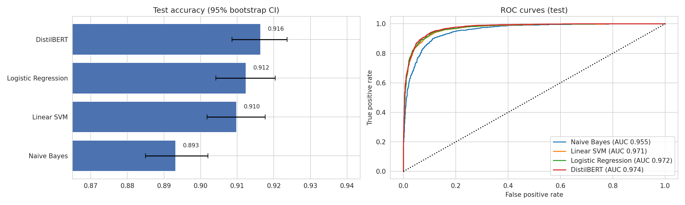
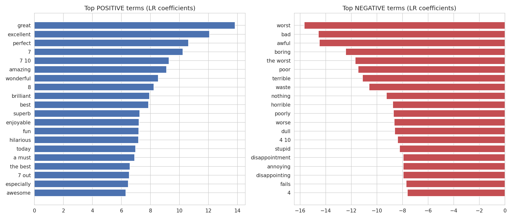
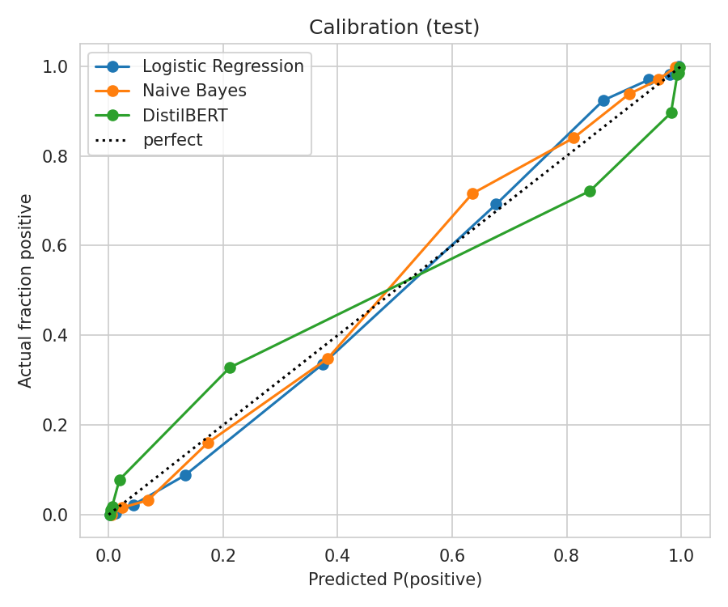
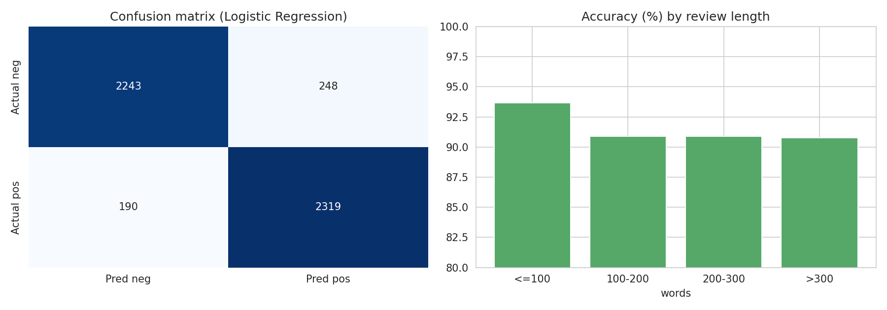
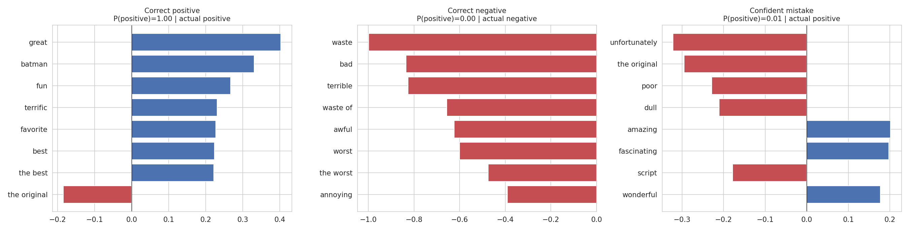

<div align="center">

# 🎬 CineSent

### IMDB Sentiment Analysis — TF-IDF vs fine-tuned DistilBERT, with explainability

**Type any movie review. See the verdict, the confidence, and exactly which words drove it.**

<br>

<a href="https://sentiment-analysis-027.streamlit.app/">
  
</a>

<br><br>


**[🚀 Live Demo](https://sentiment-analysis-027.streamlit.app/)** ·
**[📊 Results](#-results)** ·
**[✨ Features](#-features)** ·
**[⚡ Quick Start](#-quick-start)** ·
**[🧪 Methodology](#-methodology)**

</div>

---

## 🌐 Live Demo

👉 **https://sentiment-analysis-027.streamlit.app/**

No install needed. Open it, tap one of the edge-case buttons (negation, sarcasm, plot twist…) or paste your own review.

> 💤 Free Streamlit apps go to sleep after a few days of inactivity. If you see a "wake up" screen, click the button and it is back in ~30 seconds.

---

## 📌 Overview

Binary sentiment classification on **50,000 IMDB movie reviews**, done properly:

- 🧹 **Clean data** — 418 duplicates removed, HTML tags stripped
- 🔒 **Leak-free splits** — train / validation / test, test set touched once
- 🤖 **5 models compared** — Naive Bayes, Linear SVM, Logistic Regression, fine-tuned **DistilBERT**, and an ensemble
- 📏 **Honest statistics** — 95% bootstrap CIs, paired McNemar tests, calibration curves
- 🔍 **Explainable** — every prediction is broken down word by word
- 🖥️ **Interactive Streamlit app** to explore everything

| 🏆 Best accuracy | ⚡ Live model | 📦 Model size | 🧠 Features |
|:---:|:---:|:---:|:---:|
| **93.14%** (ensemble) | **91.24%** (LR, CPU) | **3.8 MB** | **200,000** TF-IDF terms |

---

## ✨ Features

| Tab | What you get |
|---|---|
| 🔮 **Live Analyzer** | Verdict, confidence gauge, **word-by-word highlighting**, top-term chart, log-odds waterfall, uncertainty and mixed-signal flags, 10 one-click edge cases |
| 📦 **Batch Lab** | Upload a CSV or paste lines → charts + downloadable predictions. Add a ground-truth column to get accuracy, macro-F1 and a confusion matrix |
| 🎞️ **Review Explorer** | Browse 300 held-out test reviews; filter by mistakes, model disagreement or confident errors |
| 🏆 **Model Arena** | Leaderboard with 95% CIs, significance tests, speed vs size, calibration, training curves |
| 🧠 **Explainability** | Strongest words and phrases, **term lookup** (compare *good*, *not good*, *not bad*), top bigrams |
| 🔬 **Errors & Data** | Accuracy by review length, stress tests, EDA and split overview |
| ℹ️ **About** | Pipeline, design decisions, limitations |

The sidebar controls the **decision threshold**, an **uncertainty band** and how many terms to show.

---

## 📊 Results

Evaluated **once** on a 5,000-review test set.

| Model | Accuracy (95% CI) | Macro F1 | ROC-AUC | Log-loss |
|---|---|---|---|---|
| 🥇 **Ensemble (LR + DistilBERT)** | **0.9314** (0.924–0.938) | 0.9314 | 0.9793 | 0.1861 |
| 🥈 DistilBERT (fine-tuned) | 0.9164 (0.909–0.924) | 0.9164 | 0.9739 | 0.2335 |
| 🥉 Logistic Regression (TF-IDF 1-2 gram) | 0.9124 (0.904–0.920) | 0.9124 | 0.9724 | 0.2171 |
| Linear SVM (calibrated) | 0.9098 (0.902–0.918) | 0.9098 | 0.9707 | 0.2188 |
| Naive Bayes | 0.8932 (0.885–0.902) | 0.8932 | 0.9555 | 0.2725 |
| Dummy (prior) | 0.5018 (0.488–0.517) | 0.3341 | 0.5000 | 0.6931 |

### 💡 Key takeaways

- **DistilBERT vs Logistic Regression:** +0.4 points, **p = 0.37** (exact McNemar) → not statistically different on 5,000 reviews.
- **Ensemble vs DistilBERT:** +1.5 points, **p < 0.0001** → averaging the two is the only clearly significant gain, because their mistakes differ.
- **Bigrams matter:** validation accuracy rose from 90.52% to 92.24% (this is how a bag-of-words model handles *not good*).
- **Why LR runs the live app:** 3.3× faster (2,508 reviews/s on CPU vs 759/s for DistilBERT on a T4), 67× smaller (3.8 MB vs 255 MB), and better calibrated.
- **Hard cases:** both models are wrong together on 203 / 5,000 reviews (4.1%) — ambiguous text, plot summaries, label noise.



<details>
<summary><b>🔍 More figures (explainability, calibration, errors)</b></summary>

<br>

**Strongest words learned by Logistic Regression**



**Calibration — can you trust the probabilities?**



**Error analysis**



**Local explanations (correct positive, correct negative, most confident mistake)**



</details>

---

## 🗂️ Project structure

```
sentiment-analysis-imdb/
├── app.py                        # Streamlit app (all tabs)
├── requirements.txt              # app dependencies (scikit-learn pinned to the training version)
├── requirements-transformer.txt  # optional: torch + transformers for live DistilBERT
├── models/
│   └── tfidf_lr.joblib           # TF-IDF + Logistic Regression pipeline (raw text → probability)
├── data/
│   └── demo_reviews.csv          # 300 held-out test reviews with LR / DistilBERT probabilities
├── artifacts/                    # metrics exported by the notebook (CSV / JSON)
├── assets/                       # figures exported by the notebook (PNG)
├── notebook/
│   └── sentiment-analysis.ipynb  # cleaning → EDA → models → DistilBERT → analysis
├── tests/test_app.py             # Streamlit smoke tests (pytest)
└── .streamlit/config.toml        # dark theme
```

---

## ⚡ Quick Start

```bash
git clone https://github.com/D0027/imdb-sentiment-analysis.git
cd imdb-sentiment-analysis
python -m venv .venv && source .venv/bin/activate      # Windows: .venv\Scripts\activate
pip install -r requirements.txt
streamlit run app.py
```

> `scikit-learn==1.6.1` is pinned because `models/tfidf_lr.joblib` was pickled with that version.

<details>
<summary><b>🤖 Optional: live DistilBERT + ensemble</b></summary>

<br>

The app ships without the 255 MB DistilBERT weights. Everything still works: DistilBERT scores for the 300 demo reviews and the 10 edge-case sentences are precomputed from the notebook. To score **any** text with DistilBERT and the ensemble:

1. Run the notebook on Kaggle (GPU + Internet on). It saves the model to `/kaggle/working/distilbert_sentiment`.
2. Zip and download it: `!cd /kaggle/working && zip -r distilbert_sentiment.zip distilbert_sentiment`
3. Unzip into `models/distilbert_sentiment/` (with `config.json`, `model.safetensors`, tokenizer files).
4. `pip install -r requirements-transformer.txt` and restart the app.

Or upload the weights to the Hugging Face Hub and point the app at the repo id:

```bash
export DISTILBERT_PATH="D0027/imdb-distilbert"      # or a local folder
streamlit run app.py
```

On Streamlit Community Cloud, put `DISTILBERT_PATH = "D0027/imdb-distilbert"` in *Secrets* and add `torch` + `transformers` to `requirements.txt`.

</details>

**Run the tests**

```bash
pip install pytest
pytest -q
```

---

## ☁️ Deploy your own copy

1. Push this repo to GitHub (the model file is only ~4 MB).
2. Go to <https://share.streamlit.io>, pick the repo, branch `main`, main file `app.py`.
3. Deploy. No secrets are needed for the default Logistic Regression mode.

---

## 🧪 Methodology

1. **Data quality** — 50,000 reviews → 418 exact duplicates removed → 49,582; HTML entities and `<br />` tags stripped.
2. **Leak-free split** — stratified 39,582 train / 5,000 validation / 5,000 test, fixed seed. Hyper-parameters chosen on validation; test used once.
3. **Classical models** — one TF-IDF vectoriser (1-2 grams, `min_df=3`, `max_df=0.9`, sublinear TF, 200k features) feeding Naive Bayes (α=0.1), Linear SVM (C=0.3, calibrated) and Logistic Regression (C=10).
4. **DistilBERT** — `distilbert-base-uncased`, custom PyTorch loop, fp16, linear warm-up/decay, max length 256, 2 epochs, best epoch on validation (val acc 92.04%).
5. **Evaluation** — accuracy with 95% bootstrap CI, macro-F1, ROC-AUC, log-loss, calibration, speed and size, exact McNemar tests.
6. **Explainability** — LR is additive, so each prediction decomposes exactly into `bias + Σ weight × TF-IDF`; the app shows this per word and per bigram.
7. **Error analysis** — accuracy by review length, confident mistakes, model disagreement, hand-written edge cases.

---

## ⚠️ Limitations

- Trained on English **movie reviews**; expect weaker results on other domains, languages or emoji-heavy text.
- A bag-of-words model cannot truly read sarcasm, long-range negation or neutral text (it rates *"nothing special, nothing terrible"* as strongly negative). The app flags mixed and low-confidence cases.
- DistilBERT reads at most 256 tokens; 40.7% of test reviews are longer.
- The task is binary, so genuinely mixed reviews have to land on one side.

---

## 📚 Dataset

[IMDB Dataset of 50K Movie Reviews](https://www.kaggle.com/datasets/lakshmi25npathi/imdb-dataset-of-50k-movie-reviews) (Maas et al., 2011). The raw data is not redistributed here; the notebook finds it automatically on Kaggle.

---

<div align="center">

### ⭐ If you found this useful, give the repo a star!

**[🚀 Try the live app](https://sentiment-analysis-027.streamlit.app/)** · MIT License

</div>